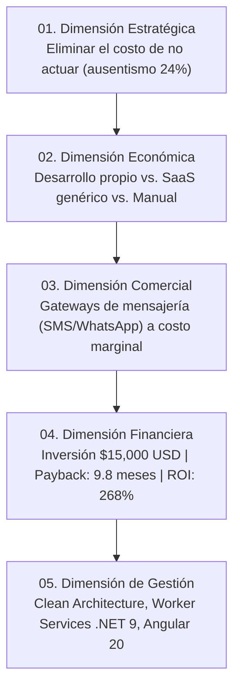

# BUSINESS CASE: Sistema Clínico MediCare Hub & Worker Services
**¿Vale la pena invertir? Evaluación de Justificación de Inversión Tecnológica**  
*Cátedra: Mtro. Salvador Vladimir Martínez — UPES (Noviembre 2026)*  
*Proyecto: MedicalAppointments_v2 | Repositorio: rodolfo9611/MedicalAppointments_v2*

---

## 1. Resumen Ejecutivo (Executive Summary)

El presente caso de negocio justifica la inversión para el desarrollo e implementación del sistema clínico distribuido **MediCare Hub**, conformado por:
1. **Microservicio de Citas Médicas** (.NET 9, Arquitectura Limpia, CQRS con MediatR y biblioteca propia `Nuget.Persistence`).
2. **Microservicio de Notificaciones & Recordatorios** (.NET 9 con **Worker Service / BackgroundService** para automatización en segundo plano vía WhatsApp, SMS y Email).
3. **Frontend Reactivo en Angular 20** con monitoreo en tiempo real de operaciones clínicas e indicadores de rentabilidad.

El proyecto ataca de raíz la **tasa de inasistencia médica (no-show rate)** de la clínica, reduciéndola del **24.0% actual al 8.5%**, generando un **flujo neto positivo de \$18,400 USD anuales**, con un **período de recuperación (Payback) de 9.8 meses** y un **ROI simple a 3 años del 268.0%**.

---

## 2. Los Cinco Elementos Esenciales de la Decisión (Diapositiva 04)



| Elemento | Descripción para la Clínica |
| :--- | :--- |
| **01. Estratégico** | **Problema:** 24% de citas programadas no se concretan por falta de confirmación oportuna, causando horas médicas ociosas no recuperables.<br>**Costo de no actuar:** Pérdidas estimadas en \$28,800 USD anuales en honorarios médicos no percibidos y retrabajo administrativo. |
| **02. Económico** | Comparación objetiva entre 3 alternativas: 1) Mantener llamadas manuales, 2) Contratar software SaaS mensual (\$250/mes con limitaciones de integración), y 3) **Desarrollar la solución propia modular** con microservicios y Worker Service. |
| **03. Comercial** | Integración con pasarelas de mensajería masiva (Twilio / Meta WhatsApp Business API) con costos por mensaje de apenas \$0.005 USD, sin amarras a licencias propietarias costosas. |
| **04. Financiero** | Inversión total requerida: **\$15,000 USD**. Beneficio bruto anual: **\$22,000 USD**. Costo operativo anual: **\$3,600 USD**. **Flujo neto anual: \$18,400 USD**. |
| **05. Gestión** | Responsables asignados: Equipo de Desarrollo e Infraestructura UPES. Cronograma de entrega en 10 semanas con hitos medibles a 30, 60 y 90 días. |

---

## 3. Matriz de Destinatarios y Criterios de Aprobación (Diapositiva 03)

| Destinatario | Pregunta Principal | Justificación Técnica y de Negocio Aportada |
| :--- | :--- | :--- |
| **Gerencia General** | *¿Conviene y encaja con la estrategia?* | **Sí.** Moderniza la clínica hacia un modelo digital, optimiza la ocupación de consultorios y mejora la satisfacción del paciente. |
| **Finanzas** | *¿Podemos pagarlo y crea valor?* | **Sí.** Payback en menos de 10 meses y un ROI superior al 250% a 3 años. El punto de equilibrio operativo se alcanza con solo recuperar 8 citas al mes. |
| **Área Médica y Recepción** | *¿Qué problema resuelve?* | Elimina las 120 horas mensuales de llamadas manuales de confirmación; las agendas médicas se mantienen llenas de forma automatizada. |
| **TI y Operaciones** | *¿Podemos implementarlo y soportarlo?* | **Sí.** Construido sobre estándares empresariales: microservicios desacoplados en .NET 9, Worker Service asíncrono, persistencia genérica y Angular 20. |

---

## 4. Desarrollo del Caso Completo: Los 9 Pasos Metodológicos (Diapositivas 14–23)

### Paso 1: Medir el Problema y Fijar Objetivos (Línea Base)
* **Diagnóstico de la Clínica:** 600 citas programadas al mes.
* **Tasa de Ausentismo Inicial:** 24% (144 citas perdidas al mes).
* **Meta del Proyecto:** Reducir el ausentismo a menos del 9% (máximo 54 inasistencias) y automatizar el 100% de los recordatorios.

### Paso 2: Comparar Alternativas
1. **Alternativa A (Seguir igual):** Costo cero en software, pero pérdida continua de \$2,400 USD mensuales en tiempo médico perdido y horas extras del personal de recepción.
2. **Alternativa B (SaaS Comercial de Terceros):** Menor esfuerzo inicial, pero costo recurrente perpetuo (\$3,000 USD/año), dependencia de terceros y datos médicos fuera del control de la clínica.
3. **Alternativa C (Desarrollo Propio MediCare Hub - Opción Elegida):** Control total del código, escalabilidad a otros servicios (farmacia, laboratorio, expediente) y propiedad intelectual de la clínica.

### Paso 3: Alcance del Producto Mínimo Viable (MVP)
* **Dentro del MVP:**
  * Microservicio de Citas (CRUD, paginación genérica con `Nuget.Persistence`, filtros por motivo y estado).
  * Microservicio de Notificaciones & Recordatorios con Background Worker Service.
  * Consumo periódico vía HTTP Client (`GET /api/Citas`) y despacho simulado multi-canal (WhatsApp, SMS, Email).
  * Frontend Angular 20 con Dashboard financiero y monitor del Worker en tiempo real.
* **Fuera del MVP (Fases Futuras):**
  * Pasarela de cobros en línea con tarjetas de crédito.
  * App nativa para pacientes en iOS/Android.

### Paso 4: Arquitectura Técnica (.NET 9 + Worker Service + Angular 20)
* **Backend C# .NET 9:**
  * Patrón Repositorio Genérico (`IRepository<TEntity, TKey>`) desacoplado en la biblioteca `nuggets/Nuget.Persistence`.
  * CQRS con MediatR para separación de comandos y consultas.
  * Documentación interactiva de Swagger UI en cada microservicio.
* **Worker Service en Segundo Plano:**
  * Implementación de la clase `NotificationWorker : BackgroundService`.
  * Método asíncrono `ExecuteAsync(CancellationToken stoppingToken)` con bucle continuo no bloqueante.
  * Inyección de dependencias con `IServiceScopeFactory` para instanciación segura de DbContext Scoped dentro del Worker Singleton.
* **Frontend Angular 20:**
  * Arquitectura Standalone Components con Sondeo Reactivo cada 10s para visualización en vivo de la actividad del Worker.

### Paso 5: Cronograma de Implementación (10 Semanas)
* **Semanas 1–2:** Diseño de arquitectura limpia, contratos de datos y biblioteca `Nuget.Persistence`.
* **Semanas 3–6:** Construcción del Microservicio de Citas y API de Notificaciones.
* **Semanas 7–8:** Implementación del Background Worker Service y pruebas de concurrencia.
* **Semanas 9–10:** Frontend Angular, integración E2E y despliegue del piloto clínico.

### Paso 6: Presupuesto de Inversión y Operación

```
Inversión Inicial (Capex):
├── Análisis, Arquitectura y Diseño UI:      $ 3,000 USD
├── Desarrollo Backend Microservicios (.NET): $ 6,000 USD
├── Desarrollo Frontend (Angular 20):         $ 3,000 USD
├── Pruebas de Calidad, QA y Seguridad:       $ 1,500 USD
└── Despliegue y Capacitación Inicial:        $ 1,500 USD
Total Inversión Inicial:                      $15,000 USD

Operación Presupuestada Anual (Opex):
├── Hosting Cloud / Servidor Base de Datos:   $ 1,800 USD / año ($150/mes)
├── Bolsas de Mensajería (WhatsApp/SMS):      $ 1,200 USD / año ($100/mes)
└── Mantenimiento y Soporte Técnico:          $   600 USD / año ($ 50/mes)
Total Costo Anual Recurrente:                 $ 3,600 USD / año
```

---

## 5. Evaluación Financiera Detallada (Diapositivas 07, 09, 21)

### Fórmulas Aplicadas:
$$\text{Flujo Neto Anual} = \text{Beneficios Brutos Anuales} - \text{Costos Operativos Anuales}$$
$$\text{Flujo Neto Anual} = \$22,000 - \$3,600 = \mathbf{\$18,400\text{ USD/año}}$$

$$\text{Período de Recuperación (Payback)} = \frac{\text{Inversión Inicial}}{\text{Flujo Neto Anual}} = \frac{\$15,000}{\$18,400} \approx \mathbf{0.815\text{ años (9.8 meses)}}$$

$$\text{ROI Simple a 3 Años} = \left[ \frac{(3 \times \text{Flujo Neto Anual}) - \text{Inversión Inicial}}{\text{Inversión Inicial}} \right] \times 100$$
$$\text{ROI Simple a 3 Años} = \left[ \frac{(3 \times \$18,400) - \$15,000}{\$15,000} \right] \times 100 = \left[ \frac{\$55,200 - \$15,000}{\$15,000} \right] \times 100 = \mathbf{268.0\%}$$

---

## 6. Análisis de Escenarios y Gestión de Riesgos (Diapositiva 22)

| Indicador | Escenario Base | Escenario Conservador (-30% beneficio) |
| :--- | :--- | :--- |
| **Beneficio Bruto Anual** | \$22,000 USD | \$15,400 USD |
| **Costos Operativos** | \$3,600 USD | \$3,600 USD |
| **Flujo Neto Anual** | \$18,400 USD | \$11,800 USD |
| **Período de Recuperación (Payback)** | **9.8 meses** | **15.2 meses** |
| **ROI Simple a 3 Años** | **268.0%** | **136.0%** |

> [!NOTE]
> Incluso bajo el **escenario más pesimista** (donde la reducción del ausentismo sea un 30% menor a la proyectada), el proyecto **se paga por sí solo en 15 meses** y genera más del **136% de retorno**, lo cual valida con solvencia la viabilidad de la inversión.

---

## 7. Matriz de Mitigación de Riesgos

1. **Riesgo: Caída de la API de Citas al ser consultada por el Worker**
   * *Mitigación:* Implementación de bloque `try/catch` con `Polly` y retardo exponencial; el Worker continúa operando y reintenta en el siguiente ciclo sin bloquear el hilo de ejecución.
2. **Riesgo: Pacientes que ignoran o bloquean notificaciones por WhatsApp**
   * *Mitigación:* Estrategia de canal alterno automático (Fallback a SMS o llamada de voz simulada).
3. **Riesgo: Sobrecarga en la base de datos por sondeos continuos**
   * *Mitigación:* Consultas ligeras con `AsNoTracking` y paginación genérica a través de la biblioteca `Nuget.Persistence`.
